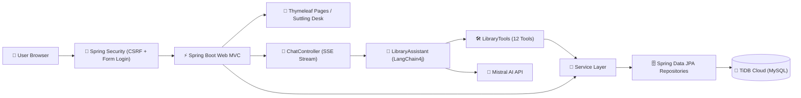

<p align="center">
  <a href="https://library-management-system-java-0phc.onrender.com/" target="_blank">
    
  </a>
</p>

<p align="center">
  <a href="https://library-management-system-java-0phc.onrender.com/" target="_blank">
    
  </a>
</p>

<p align="center">
  <a href="#features">Features</a> ·
  <a href="#architecture">Architecture</a> ·
  <a href="#ai-concierge">AI Concierge</a> ·
  <a href="#quick-start">Quick Start</a> ·
  <a href="#configuration">Configuration</a> ·
  <a href="#api">API</a> ·
  <a href="#database">Database</a> ·
  <a href="#project-structure">Structure</a>
</p>

<p align="center">
  
  
  
  
  
  
  
  
</p>

---

A full-featured **college OOPS project**: a library management system built with **Java 21** and **Spring Boot**, backed by a real **MySQL** relational database (hosted on **TiDB Cloud**) with a streaming chat widget powered by a LangChain4j AI concierge. Manage books, members, employees, subscriptions, payments, and issues — or just ask **Lumina Concierge** in plain language.

This is the **third version** of the project — following the [original Google-Sheets app](https://github.com/kairav7220/library-management-system) (v1, Flask + Vercel) and the [DBMS edition](https://github.com/kairav7220/library-management-system-dbms) (v2, Flask + MySQL on TiDB Cloud). This **Java edition** (v3) rebuilds the same system with Spring Boot: same database, same 12-table schema, same Suttling Desk UI, and the same SSE chat contract.

## Features

- **📚 Database-Backed CRUD** — 12 normalized tables for books, members, employees, subscriptions, payments, sales, and issues
- **🔐 Login & Role Gate** — Spring Security form login with `Admin` / `Employee` / `Member` roles; legacy Python scrypt hashes verified alongside new BCrypt passwords
- **🛡️ CSRF Protection** — per-session CSRF tokens on every form and the chat endpoint
- **🤖 Lumina AI Concierge** — a single LangChain4j agent with 12 tools (9 read + 3 write) grounded in the real database
- **⚡ Token-Level Streaming** — replies stream live via Server-Sent Events (`delta` → `done`), byte-compatible with the Python chat widget
- **💰 Fine Policy** — 14-day loans with ₹10/day overdue fines, queryable by the concierge
- **📄 Audit Logging** — every login/logout recorded in the `logs` table; admin-only `/logs` page
- **🗂️ Chat History** — multi-session history with resume and clearing
- **📱 Responsive UI** — Suttling Desk theme (Space Grotesk + Source Sans 3) with an interactive chat launcher

## Architecture



| Layer | Technology |
|---|---|
| **Frontend** | Thymeleaf templates + streaming `chat.js` (Suttling Desk design system) |
| **API** | Spring Boot Web MVC — CRUD pages + `POST /chat/stream` SSE |
| **Orchestration** | LangChain4j `@AiServices` — one concierge, 12 `@Tool`s, in-memory chat memory |
| **LLM** | Mistral (`open-mistral-7b` via `langchain4j-mistral-ai`) |
| **Database** | MySQL-compatible relational DB via Spring Data JPA (Hibernate 7) |
| **Cloud DB** | TiDB Cloud (MySQL-compatible serverless) |
| **Deployment** | Render Web Service (multi-stage Docker, Temurin JRE 21) |

## AI Concierge

One concierge instead of five agents — a single LangChain4j service answers every request through a fixed set of database tools:

| Tool | Type | What it does |
|---|:---:|---|
| `searchBooks` | 📖 Read | Search books by title, author, category, genre, or id |
| `getBook` | 📖 Read | Full details of one book, including who holds it now |
| `searchMembers` | 📖 Read | Find members by name, email, phone, or id |
| `getMyIssuedBooks` | 📖 Read | Books currently issued to the logged-in member |
| `getIssuesForMember` | 📖 Read | All issue records (open + closed) for a member |
| `checkFine` | 📖 Read | Overdue fine for a member or a book |
| `getOverdueBooks` | 📖 Read | All overdue books across the library |
| `getLibraryStats` | 📖 Read | Books, members, issued, overdue, and revenue totals |
| `getSubscriptionPlans` | 📖 Read | Monthly / Quarterly / Yearly plans and pricing |
| `issueBook` | ✍️ Write | Issue a book to a member (validates availability) |
| `returnBook` | ✍️ Write | Return a book and report the fine, if any |
| `registerMember` | ✍️ Write | Register a new member |

## Quick Start

```bash
git clone https://github.com/kairav7220/library-management-system-java.git
cd library-management-system-java
```

Copy `.env.example` to `.env` and fill in your keys (see [Configuration](#configuration)):

```env
MYSQL_HOST="gateway01.ap-southeast-1.prod.aws.tidbcloud.com"
MYSQL_PORT=4000
MYSQL_USER="<tidb-user>.root"
MYSQL_PASSWORD="your_tidb_password"
MYSQL_DB="library_db"
MISTRAL_API_KEY="your_mistral_api_key_here"
```

Then run:

```bash
./mvnw spring-boot:run      # Windows: mvnw.cmd spring-boot:run
```

Open `http://localhost:5000`, log in, and use the admin pages or the **Lumina Concierge** chat widget.

## Configuration

| Variable | Required | Purpose |
|---|---|---|
| `MYSQL_HOST` | ✅ | TiDB Cloud host (`gateway01...tidbcloud.com`) |
| `MYSQL_PORT` | ✅ | TiDB Cloud port (`4000`) |
| `MYSQL_USER` | ✅ | TiDB user, e.g. `<cluster>.root` |
| `MYSQL_PASSWORD` | ✅ | TiDB database password |
| `MYSQL_DB` | ✅ | Database name (`library_db`) |
| `MISTRAL_API_KEY` | ✅ | Mistral LLM for the concierge |
| `LUMINA_MODEL` | optional | Concierge model (default `open-mistral-7b`) |
| `LUMINA_FINE_PER_DAY` | optional | Overdue fine per day (default ₹10) |
| `PORT` | optional | HTTP port (default `5000`) |

> **Note:** `.env` in the project root is loaded automatically at startup. TiDB requires TLS — the JDBC URL always connects with `sslMode=REQUIRED`.

## API

| Method | Endpoint | Description |
|---|---|---|
| `GET` | `/login` | Login page (form login) |
| `GET` | `/` | Dashboard — stats and recent audit logs |
| `GET` | `/logs` | Admin-only audit log |
| `POST` | `/chat/stream` | SSE streaming concierge reply (`delta` → `done` events) |
| `GET` | `/chat/history?session_id=` | Turn history for a session |
| `GET` | `/chat/sessions` | List saved sessions |
| `DELETE` | `/chat/sessions/<id>` | Delete a session |
| `GET` | `/books`, `/members`, `/employees`, … | CRUD list pages (Thymeleaf) |
| `POST` | `/books/add`, `/members/add`, … | CRUD create |
| `GET`/`POST` | `/books/edit/<row>`, … | CRUD update |
| `POST` | `/books/delete/<row>`, … | CRUD delete (CSRF-protected) |

## Database

MySQL schema (`schema.sql`) — 12 normalized tables, **shared live with the Python version**:

| Table | Purpose |
|---|---|
| `users` | App login accounts (Admin / Employee / Member) |
| `books` | Book catalog |
| `book_category` | Book categories |
| `book_genre` | Book genres |
| `members` | Registered members |
| `employees` | Staff |
| `subscriptions` | Membership plans |
| `payments` | Payment transactions |
| `book_sell` | Book sales |
| `book_issues` | Book issue / return records |
| `logs` | Login / logout audit trail |
| `customers` | Customer records |

The schema enforces **referential integrity with foreign keys** — e.g. `book_issues.book_id → books(book_id)`, `payments.recieved_by → employees(emp_id)` — so the DB rejects orphaned or invalid references. New IDs are generated sequentially (`BOOK_1`, `MEM_1`, `TXN_1`, …) by the `IdGenerator` service.

## Deployment (Render)

Runs as a **Render Web Service** (persistent process — required for MySQL connections and SSE streaming).

- **Runtime:** Docker — multi-stage build (Maven → Temurin JRE 21)
- **Port:** bound via Render's `$PORT`, health check on `/login`
- **Env group:** `MYSQL_*` (TiDB Cloud), `MISTRAL_API_KEY`

## Project Structure

```
library-management-system-java/
├── pom.xml                     # Maven build (Spring Boot 4.1)
├── Dockerfile / render.yaml    # Container build + Render blueprint
├── .env.example                # Environment template
├── src/main/java/com/library/lms/
│   ├── ai/                     # LangChain4j concierge
│   │   ├── LibraryAssistant.java  # @AiServices interface + persona
│   │   ├── LibraryTools.java      # 12 @Tool methods
│   │   └── ChatContext.java       # ThreadLocal member context
│   ├── config/                 # Security, Web, and LangChain4j config
│   ├── controller/             # MVC controllers (CRUD + chat + dashboard)
│   ├── entity/                 # 12 JPA entities
│   ├── repository/             # 12 Spring Data repositories
│   ├── security/               # CompositePasswordEncoder + auth handlers
│   ├── service/                # Business logic (Issue, Fine, Id, …)
│   └── web/                    # Flash messages, dropdowns, advice
├── src/main/resources/
│   ├── application.properties  # Config (loads .env automatically)
│   ├── schema.sql              # MySQL schema + seed data (12 tables)
│   ├── static/                 # chat.js + Suttling Desk CSS
│   └── templates/              # Thymeleaf pages (login, books, chat widget, …)
└── src/test/java/              # JUnit 5 suites (security, SSE, fines)
```

## License

MIT © [kairav7220](https://github.com/kairav7220)

---

<p align="center">
  Built with <a href="https://spring.io/projects/spring-boot">Spring Boot</a> ·
  <a href="https://github.com/langchain4j/langchain4j">LangChain4j</a> ·
  <a href="https://mistral.ai">Mistral AI</a> ·
  <a href="https://www.mysql.com">MySQL</a> ·
  <a href="https://www.tidbcloud.com">TiDB Cloud</a> ·
  <a href="https://render.com">Render</a>
</p>
